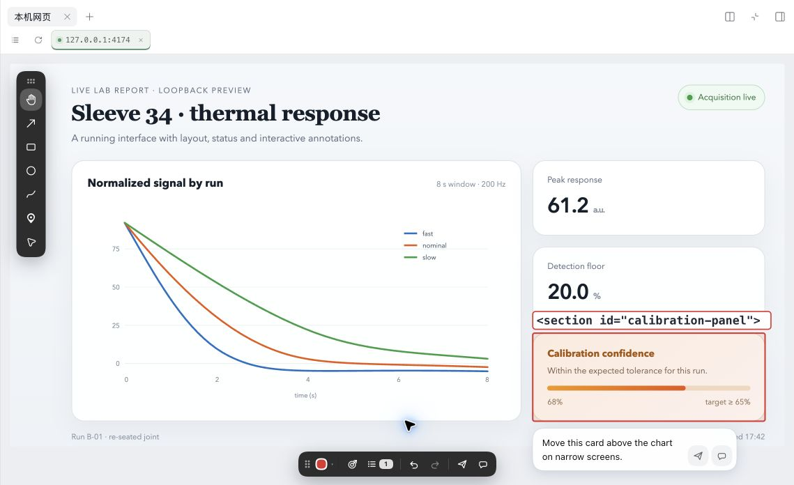
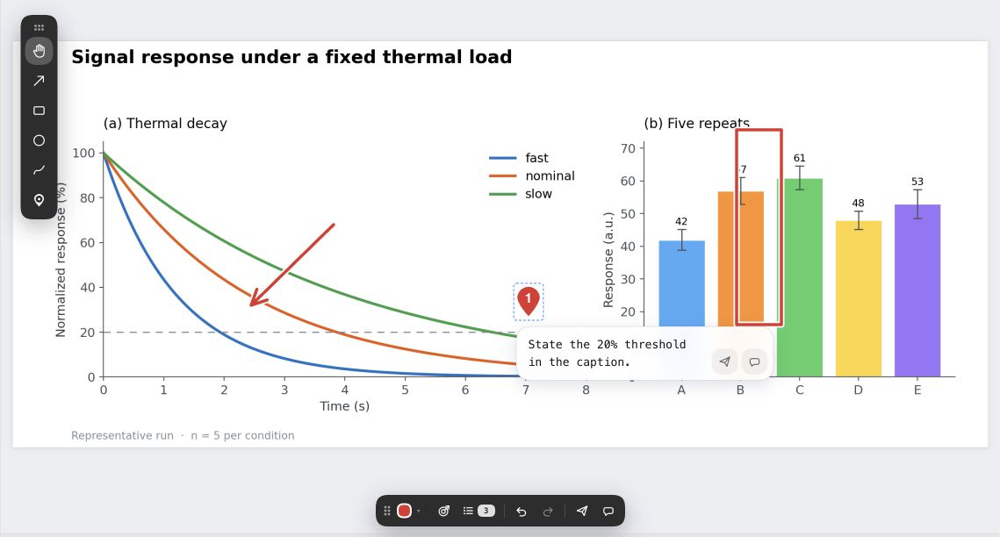
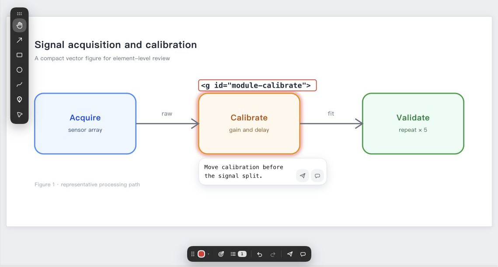
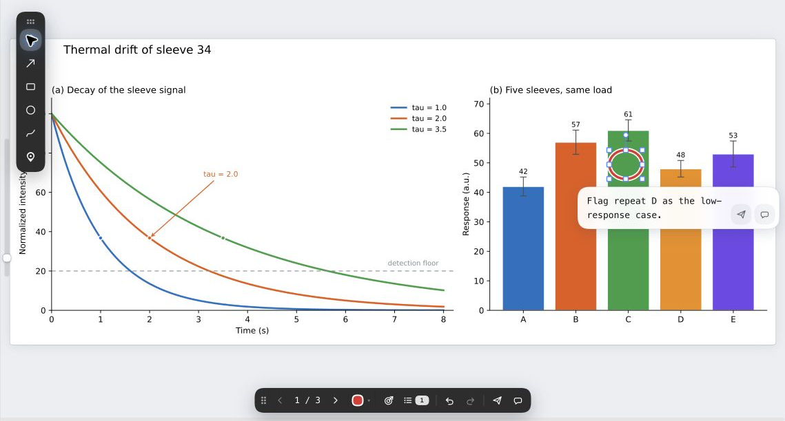

# dsh-figmark

DeepSeek Harness 插件：在右侧栏的文档预览里**直接圈画批注**科研配图，然后把批注**当作一条用户消息交给智能体**——让它按你圈的位置去改生成源（Python 脚本、DOT、SVG），而不是靠你打字描述「左边第二条曲线的图例要挪上去」。

<p align="center"></p>

> annotate a figure (image / SVG / PDF) or a locally served web page in the right-sidebar preview and hand the marks to the agent as one user message. Original files are never modified: file marks live in a sidecar next to them.

<p align="center">
  
</p>
<p align="center"><sub>本机网页：直接在运行中的页面上选择元素、写评论；页面仍保留自己的脚本、布局和交互。</sub></p>

<table>
  <tr>
    <td width="50%">
      <br>
      <sub>图片：箭头、区域和 pin 评论留在原图之上，批注文字不会被烧进图片。</sub>
    </td>
    <td width="50%">
      <br>
      <sub>SVG：不只画框，直接选中图元或分组，拿到可回源码定位的锚点。</sub>
    </td>
  </tr>
  <tr>
    <td colspan="2">
      <br>
      <sub>PDF：逐页批注，保存时写成阅读器可继续编辑和删除的原生注释对象。</sub>
    </td>
  </tr>
</table>

## 它解决的问题

科研图的返工意见大多是**位置性的**：「这个标号指错了」「这里少一条图例」「这条误差棒太长了」。用文字描述既慢又容易误解，而只发一张截图给模型，它只知道「图上有个红框」，不知道红框框的是哪一行元素。

dsh-figmark 把三样东西一起交给智能体：

1. **图面坐标** —— 每条标注的几何（箭头两端 / 框的对角 / 单点的位置）；
2. **落在哪个元素上** —— SVG 给 `tag`/`id`/`title`/元素文字/包围盒，HTML 给一条从 `body` 起可直接命中的 `selector`；消息里只保留说得清名字的那几项（元素 `id`、只由 `id` 组成的 `#id` 选择器、超长的元素文字、指认整张图本身的锚点都不再打印；有标题或短文本就报那个词，HTML 则报能被源码命中的路径）；
3. **你那句话** —— 每条标注一段「这个元素要改什么」，外加一段「这张图整体要往哪个方向改」。

## 支持范围

| 文档类型 | 后缀 | 状态 |
|---|---|---|
| 图片 | `png` `jpg` `jpeg` `gif` `webp` `bmp` `ico` | ✅ |
| SVG | `svg` | ✅ 内联渲染，支持图元锚定 |
| PDF | `pdf` | ✅ 整份文档一份批注：逐页画、一次保存，写回**原生 PDF 注释对象** |
| 静态 HTML | `html` `htm` | ✅ 只读预览，可运行自包含页面脚本；不加载、不写入标注侧车 |
| 本机网页 | `http://localhost` / `127.0.0.1` / `[::1]` | ✅ 在右侧栏「本机网页」里发现并打开；真实脚本、路由、媒体与元素锚定可用 |
| Office | `doc` `docx` `ppt` `pptx` `xls` `xlsx` | ⏳ 待接入，仍由内置预览器打开 |

## 输入框附图的独立批注（测试功能）

添加图片后，直接点击输入框里的原生缩略图即可在原图上标注；工具条悬浮在图片右侧，支持画笔、箭头、矩形、椭圆和 Pin 评论，以及移动、缩放标记、改色、撤销/重做。

「加入输入框」会生成标注 PNG，并把逐条评论追加到现有草稿一起发送；原图保持不变，已有文字保留，之后由你确认附件和评论并按宿主的发送按钮。编辑、取消和下载均不调用智能体，不建立批注队列，也不写侧车文件。

当前保留一张图的临时批注，刷新或明确清除后不保留可编辑图层；导出的 PNG 为静态副本。完整步骤、宿主兼容性与待实测项目见 [附图标注测试说明](docs/attachment-annotator-testing.md)。

## 安装

### 从插件市场安装（推荐）

在 DSH 里打开 **侧栏 → 插件 → 实验性插件 → 更多 → 自定义插件市场**，添加索引地址：

```
https://raw.githubusercontent.com/KafukaTree/dsh-figmark/main/market/index.json
```

然后在**发现**页搜 `figmark` 安装。安装完成后 **Cmd+Q 完全退出重开** DSH。

### 从 npm 安装

```sh
dsh plugin add dsh-figmark
```

`dsh plugin add` 会把它写进 profile 的依赖并加入 `dsh.profile.bundles`。装完同样要完全退出重开。

### 从源码开发

```sh
git clone https://github.com/KafukaTree/dsh-figmark.git
cd dsh-figmark
pnpm install
pnpm run build          # 产出 lib/index.js（Host）与 lib/client.js + lib/client.pdf.js（Client）
dsh plugin add "$PWD"
```

**改动 Host 半后必须重启宿主进程**——Node 会缓存已导入的模块；Client 半只需刷新页面。开发时建议用隔离实例：

```sh
DSH_HOME=/tmp/figmarkdev dsh --profile figmarkdev --port 3099 --no-open
```

## 用法

打开右栏的图片 / SVG / PDF，或在「本机网页」里打开正在运行的 loopback 服务，底部就是全部控件：

- **左侧浮条**：选择（鼠标指针）· 箭头 · 框选 · 圈选 · 手绘 · 单点。除「选择」外每个工具画完**自动回到选择**并选中刚画的那个，说明框随之弹出、光标已经在里面。
- **底部浮条**：标注样式（颜色折叠面板）· 撤销 / 重做 · 总体目标 · 标注清单 · 发送给智能体 / 发送到对话框。
- 两条浮条都能**拖动**，位置记在浏览器里，下次打开还在原地。
- 图上只画标记，**不把文字画到图上**。编号只画在单点上（地图水滴的滴头里），序号是它在**本类标注里**的位置，和消息里那句「单点2」是同一个数；箭头/矩形/椭圆/手绘/元素标注在图上不带数字，消息里按「箭头1」「矩形1」「元素1」这样称呼它们。
- **标注清单**按种类聚在一起排（箭头 → 矩形 → 椭圆 → 手绘 → 单点 → 元素），同类里按画的先后；每行以图标靠左起头，序号是图标右下角的 8px 小字，且只在同一类有两条以上时出现——某一类只有一条那一行不印数字，数字是用来区分两样的，不是列表行号。
- 选中标注后可以**拖动改位置**；框/椭圆/手绘拖角或边上的手柄**改大小**、拖顶部手柄**旋转**（按住 Shift 吸附 15°）；箭头没有控制框，只有两端两个圆点，拖哪一端就只动哪一端。一次手势 = 一步撤销。
- 触控板捏合缩放，缩放中心跟指针；「选择」工具下直接拖动就是平移。
- 双击图上的标注 = 打开它的说明框；`Esc` 取消选中；`Delete`/`Backspace` 删除选中标注。
- 编辑会**自动保存**（防抖 600ms），刷新、重开都不丢；只有点「发送」成功后才清空面板并删掉磁盘上的批注文件。
- 点击已发送批注卡片会回到对应的文件或「本机网页」标签；已经打开的 live page 保持原 frame、滚动位置和页内状态，不会被重新打开。

### 本机网页：只标注正在运行的服务

静态 `.html` 文件使用 Figmark 的只读预览：没有标注工具，也不读写侧车。自包含页面里的内联脚本可以运行，外部子资源、`fetch`/XHR、表单与嵌套帧被 CSP 拒绝；opaque sandbox 隔离了 DSH 应用源，但脚本仍可导航自己的预览 frame，因此预览只应打开可信 HTML。要标注正在开发的动态页面，先在右侧栏打开「本机网页」：

- 扫描范围是有界的：最近打开过的地址、当前 workspace `package.json` 脚本里显式写出的端口，以及一小张常见开发端口表；不会扫 `1–65535`，也不会执行任意启动命令。
- 选一项或输入 `localhost:5173` 后，Host 建立一次一页的 `127.0.0.1` live proxy。页面保持自己的路由、脚本、动画、表单、音视频和滚动；同源重定向继续留在 proxy 上，页面级 CSP meta 不会把 picker 拦掉。元素模式通过注入的 picker 取得悬停元素、层级与实时包围盒。
- 代理在应用之外打开源；元素锚定只通过 `postMessage` 回到面板，父页不读取运行页 DOM。关闭页面或面板时监听器与连接一起销毁。
- 元素模式下，悬停会预览将选中的元素，`↑↓` 调整层级，点击落一条可回源定位的元素标注；箭头 / 框 / 圈 / 手绘仍叠在页面上。标注清单会显示 `<tag#id.class = "text">`，点击后先让页面定位，页面确认可见才选中。
- 左上地址抽屉默认收成一个图标，展开只从原位置向右生长；Enter 打开地址，Esc 恢复当前页地址，打开或返回后自动收起。
- 服务页的批注没有侧车文件可写：页面地址就是消息里的路径，元素 `selector` 是回源定位的主锚点。
- **只有当前可见的绘图标注才触发页面截图**：只有元素选择或 pin 时不生成、也不等待截图；箭头 / 框 / 圆 / 手绘会截取当前可见 surface 并叠加其中可见的标注；其他 slide 或视口外的标注改由 `surface`、元素选择器和坐标定位。

### 两个发送按钮

| 按钮 | 行为 |
|---|---|
| **发送给智能体** | 批注+标注图作为一条用户消息**直接发进当前会话** |
| **发送到对话框** | 只**写进输入框草稿**（连同图片附件），你自己看完再按回车 |

本机网页的纯元素选择或纯 pin 批注不生成截图，消息会标记为「位置标注」并直接发送；包含可见绘图的批注只截当前 surface。文件图片、SVG 与 PDF 的导出规则不受这条 live-page 策略影响。

## 产物

批注**从不修改原文档**，只在旁边写文件：

| 文件 | 内容 |
|---|---|
| `<名>.<后缀>.annot.json` | 批注文档：图信息（绝对路径、sha256，PDF 另有 `pageCount`）、`marks[]`（kind/color/points/rotation/page/anchor/detail）、总体目标 |
| `<名>.<后缀>.annotated.png` | 图片/SVG：原图 + 批注的合成图（最高 2× 分辨率），作为图片附件随消息发送 |
| `<名>.<后缀>.annotated.pdf` | PDF：原件副本，批注写成**原生 PDF 注释对象**，作为附件随消息发送 |
| —— | 本机服务页：**不留文件**；消息携带页面地址与每条 `anchor.selector` |
| —— | 静态 HTML：只读预览，不产生任何文件或消息 |

名字**带着被批注文件自己的扩展名**（`fig1.svg` → `fig1.svg.annot.json`），所以同目录下同主名不同后缀的两份文件各有各的批注、绝不会互相读错。

`marks[].points` 是**图面像素坐标**（原点左上）；PDF 的坐标是该页的页面单位（PDF 点），因此缩放、翻页、旋转页都不影响指向。原图被重新生成后 sha256 变化，插件会提示旧批注可能失准。

带批注的 PDF 里，箭头是 `/Line`、框选 `/Square`、圈选 `/Circle`、手绘 `/Ink`、单点 `/Text`，各自带自绘外观流，所以在 Acrobat、Preview、浏览器内置查看器里看到的形状与页面上一致，也能继续编辑或删除。旋转过的框会烘焙成折线（PDF 的 `/Square` 按定义轴对齐，转不了）。

插件还会注入一段系统提示，告诉智能体拿到【附图标注】消息后该怎么处理：**改生成源，不涂改导出的位图**，未标注处不动，逐条回应。

## 与同工作区的其它批注器互通

同一工作区里的姊妹批注器（Sati）把批注写进同一份侧车文件，但用 **v2 形状**（`target` 而非 `figure`）。本插件读得懂 v2、继续写自己的 v1，所以两边都能看到对方留下的批注；回存时 v2 独有、本插件不建模的字段会丢。

早期版本的两种命名仍会被读回（只读回退）：按主名的 `fig1.annot.json`，以及 PDF 按页各一份的 `report.pdf.p3.annot.json`（会被合并成一份显示，旧文件原样保留）。

## 已知限制

- **不做图面编辑**：插件只采集批注，不改图；修图仍由智能体改生成源完成。
- **栅格图没有元素锚定**：PNG/JPEG 只有像素坐标，锚定信息仅 SVG 与 HTML 有。
- **PDF 只写原生注释对象**：不做「把标记烧进页面内容」的副本。好处是标记在阅读器里仍可编辑删除；代价是只看页面内容、不渲染注释的流程看不到标记（那种场合用消息里附的每页图片）。
- **PDF 一次一页**，无文本层、无连续滚动。
- **本机网页必须有正在运行的 loopback 服务**：静态文件只有 Figmark 的只读预览；Figmark 不替用户扫描全部端口，也不执行任意 workspace 命令。
- **服务页截图只覆盖当前可见 surface**：不会为了截图重建历史页面、跨 slide 拼接或截取视口外内容；这些标注靠 `surface`、元素 selector、坐标和文字定位。
- **Office 尚未接入。**

## 最近更新

`1.2.2` 聚焦本机网页批注的真实使用体验：

- 元素与 pin 单独成批时跳过截图，常见审阅路径立即完成。
- 只有可见绘图触发一次截图，跨页与视口外标注改由结构化位置描述。
- 批注卡片会回到正确的「本机网页」标签，返回列表和刷新不销毁已打开的页面。
- 多个 live page 各自保留草稿、滚动位置与页内状态，切换标签不会串页。
- 「本机网页」入口新增与相邻工具一致的本地服务图标。

完整构建与覆盖信息见 [CHANGELOG.md](./CHANGELOG.md)。

## 开发

开发规范（门禁、负控制、决策记录、架构红线）的家在 [`AGENTS.md`](./AGENTS.md)，开工前先读 §2。决策背景在 [`docs/notes/`](./docs/notes)。

```sh
pnpm run check      # 三个门禁一次跑完：typecheck + lint + test:coverage
pnpm run build      # tsc --noEmit + tsdown（Host ESM / Client 单文件 CJS + PDF 懒加载分块）
pnpm test           # vitest
```

Client 半边必须匹配 DSH 动态客户端契约：单文件 CJS、唯一副作用是 `window.__ModuleLoader__.load({id, factory})`、只把 `react`/`react/jsx-runtime`/`react-dom` 留给模块表，其余全部内联——插件路由只发 `client.*.js`，发不了字体等静态资产。PDF 那一半（PDF.js + pdf-lib）住在懒加载分块里，且**分块不得与主包共享任何模块**，否则主包会同步 `require` 一个它拿不到的文件。

## 许可

MIT，见 [LICENSE](./LICENSE)。
